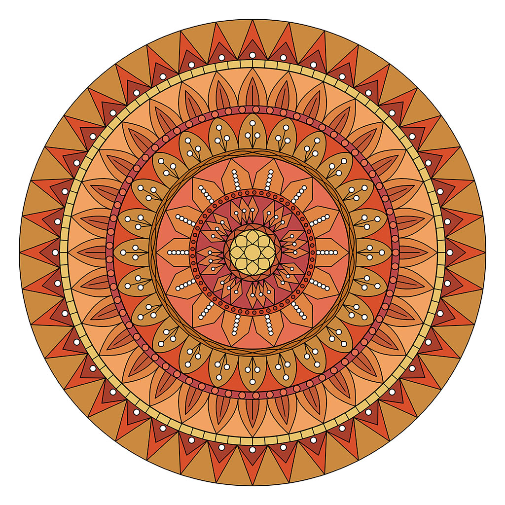
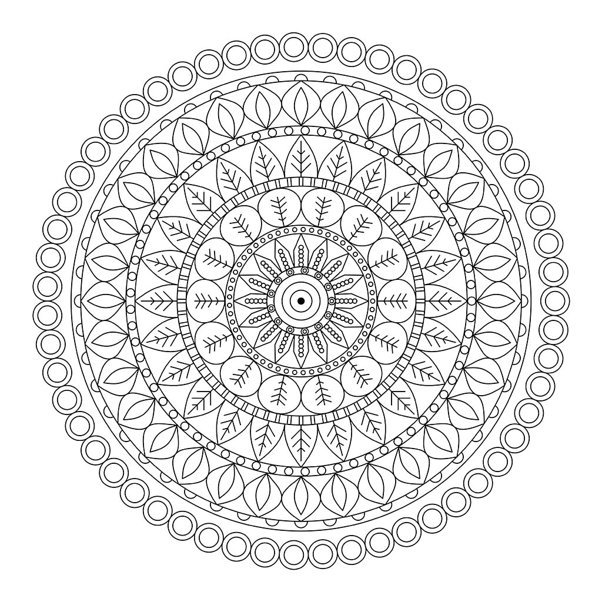

# Mandala Generator

A mandala generator in Python + Cairo. The program assembles a
mandala from independent modules — a central pattern, five
separator bands, and five petal layers — randomly combining styles
and colors, draws it in a window as an animation, and then saves
the result as a vector PDF (or raster PNG/JPG) and writes a
detailed log to a text file.

The code was written using LLM (Large Language Model).


> 🪟 **Windows without Python:** see [README_Windows.md](README_Windows.md) —
> a ready `MandalaSetup.exe` installer and a portable build. Drawing
> parameters are set via a settings window or an external `config.ini`.

## 🖼️ Examples

<div align="center">


&nbsp; &nbsp; &nbsp; &nbsp;


</div>

---

## Table of contents

1. [Quick start](#quick-start)
2. [Project structure](#project-structure)
3. [How it works](#how-it-works)
4. [Animation and drawing speed](#animation-and-drawing-speed)
5. [Configuration parameters](#configuration-parameters)
6. [Pattern styles](#pattern-styles)
7. [Color palettes](#color-palettes)
8. [Color selection: rules and restrictions](#color-selection-rules-and-restrictions)
9. [Saving the result](#saving-the-result)
10. [Logging](#logging)
11. [Running from VS Code](#running-from-vs-code)
12. [Requirements](#requirements)
13. [FAQ](#faq)

---

## Quick start

From the project root (the directory that contains the `mandala/`
folder):

```bash
python -m mandala
```

The `-m` flag tells Python: "find the specified package/module and
execute it as a program". For `python -m mandala`, Python looks for
the `mandala` package in the current directory (and in
`PYTHONPATH`), runs its `__main__.py`, which calls `main()`. That is
why the command must be run from the folder that contains
`mandala/` — otherwise Python will not find the package.

or

```bash
python -m mandala.main
```

The mandala is drawn in a window as an animation; when the drawing
is finished, a `YYYY-MM-DD-mandala-HHMMSS.pdf` file (or `.png` /
`.jpg`) appears in the `img/` directory, and an entry is appended to
`YYYY-MM-mandala.log` in the `log/` directory.

If you work in VS Code and want to run it with the **Run code**
button on `mandala/main.py`, that is supported too (see
[Running from VS Code](#running-from-vs-code)).

---

## Project structure

```
mandala/
├── __init__.py          # package marker (may be empty)
├── __main__.py          # enables `python -m mandala`
├── main.py              # orchestrator: wires the modules, starts generation
├── config.py            # Config class — all settings
├── runtime.py           # Cairo scene, Tkinter window, turtle-like API,
│                        # animation manager, drawing speed, phase timing
├── traj.py              # animation trajectory elements: Line, Arc, Bezier,
│                        # FillElement (fill), StrokeElement (outline)
├── selection.py         # color and style selection (weighted random + rules)
├── geometry.py          # shared drawing helpers (circles, polylines, ovals)
├── centers.py           # 11 center variants + SVG parser for the Om symbol
├── bands.py             # 12 separator band styles
├── layers.py            # 17 petal layer styles
├── logging_utils.py     # log formatting and writing
├── export.py            # scene saving: vector PDF via Cairo,
│                         # PNG/JPG raster via PIL
├── app_paths.py         # data locations: images, logs, config.ini
├── settings.py          # external config.ini applied over config.py
├── settings_dialog.py   # settings window (Tkinter) before drawing
└── cairo_backend.py     # Cairo backend: pycairo (Windows) / cairocffi (dev)
```

Next to the package, the repository root also contains
`mandala_app.py` (entry point of the Windows build), `windows/`
(installer build kit) and `tests/`; see [README_Windows.md](README_Windows.md).

During operation the following working directories are created
(inside the project directory):

```
img/                     # results: PDF/PNG/JPG
log/                     # monthly text logs
```

### Module responsibilities

| Module | Responsibility |
| --- | --- |
| `config.py` | Data only: background/line colors, radii, widths, palettes, style catalogs, modes. **Imports nothing** from the project — a leaf of the dependency tree. |
| `traj.py` | Animation elements with real arc length: `Line`, `Arc`, `Bezier` (arc-length parameterization via a LUT), `FillElement` (fill, zero length), `StrokeElement` (outline of a finished contour). |
| `runtime.py` | Tkinter window + Cairo scene, turtle-like API (`goto`, `penup`, `pendown`, `begin_fill`, `circle`, etc.), merging consecutive fill arcs into a single circle contour, animation manager (`AnimationManager`), baked layer (`_bake`), phase timing. |
| `selection.py` | Palette state (`COLOR_ENABLED`, `ACTIVE_PALETTE`), the `pick_color_no_adjacent`, `pick_colors_for`, `pick_styles_with_rules`, `weighted_choice_styles` functions, and the `colors_count_for_*` counters. |
| `geometry.py` | `draw_circle_from_center`, `fill_ring`, `petal_points`, `draw_polyline`, `draw_oriented_oval`, `shape_leaf`, `draw_small_circle`. |
| `centers.py` | The `center_v1..center_v11` functions + `draw(style_idx, r, colors)` dispatcher. Includes the SVG parser for Om. |
| `bands.py` | `generic_band()` + `band1_run..band5_run` + `draw_band(index, r, w, colors)` dispatcher. |
| `layers.py` | `draw_layer_core()` + `layer1_run..layer5_run` + `draw_layer(index, r, ring, petal_colors)` dispatcher. |
| `logging_utils.py` | `build_start_log`, `write_start_log`, `build_end_log`, `write_end_log`, `setup_log_path`. |
| `export.py` | `save_mandala(scene, mandala_name)` — writes the scene directly to a PDF (`cairo.PDFSurface`) or rasterizes it to PNG/JPG via PIL. |
| `main.py` | Ties everything together: picks styles and colors, launches drawing, saves the result. Plus a "hack" for direct execution (`Run code`). |

### Dependency graph

```
config  ←  runtime  ←  geometry  ←  centers
                       ↑            ←  bands
                       ↑            ←  layers
config  ←  selection
config  ←  logging_utils
config  ←  export  ←  runtime
main    →  everything above
```

`config.py` imports nothing from the project. `runtime.py` depends
only on `config` (plus external libraries). `selection.py` — only
on `config`. Everything else is assembled in `main.py`.

---

## How it works

### The general idea

A mandala is a **set of concentric areas**. The areas are of two
types:

- **Center** — a circle with radius `CIRCLE_RADIUS`.
- **Separator bands** — narrow rings between the layers.
- **Petal layers** — wide rings filled with a repeating petal
  pattern.

The areas go strictly in order:

```
center
  band 1   (BAND1_WIDTH)
  layer 1  (L1_WIDTH)
  band 2   (BAND2_WIDTH)
  layer 2  (L2_WIDTH)
  band 3   (BAND3_WIDTH)
  layer 3  (L3_WIDTH)
  band 4   (BAND4_WIDTH)
  layer 4  (L4_WIDTH)
  band 5   (BAND5_WIDTH)
  layer 5  (L5_WIDTH)
```

Radii are computed in `main._compute_radii()` by simple
accumulation:

```python
r_band1_start = CIRCLE_RADIUS
r_layer1_start = r_band1_start + BAND1_WIDTH
r_band2_start = r_layer1_start + L1_WIDTH
...
```

### The flow of `main.main()`

1. **`runtime.apply_draw_speed(DRAW_SPEED_LEVEL)`** — stores the
   target drawing duration (see
   [Animation and drawing speed](#animation-and-drawing-speed)).

2. **`selection.init()`** — determines `COLOR_ENABLED`
   (`"yes"`/`"no"`/`"random"`), picks the palette family
   (`PALETTE_CHOICE`), and fills `ACTIVE_PALETTE`.

3. **Style selection** — `weighted_choice_styles` for the center,
   `pick_styles_with_rules` (with `max_repeat=1`, i.e. no repeats)
   for the 5 bands and 5 layers.

4. **Color selection** (`_pick_all_colors`) — area by area, top
   down, with repeat restrictions (see below).

5. **Start log** — which styles and colors were chosen.

6. **Drawing** — in order: `centers.draw`, `bands.draw_band`,
   `layers.draw_layer` for each area. Every call is wrapped in
   `_tmark(...)` for timing. Operations are recorded into the Cairo
   vector scene (`Scene`) and into the `AnimationManager`
   trajectory.

7. **Animation** — `runtime.done(lambda: ...)`: the window shows
   the drawing live (see the section below); the mainloop tick is
   `after(16)` ≈ 60 frames/s.

8. **Saving** — after the animation finishes,
   `export.save_mandala(scene, mandala_name)`: the vector scene is
   written directly to a PDF via `cairo.PDFSurface` or rasterized
   to PNG/JPG via PIL.

9. **End log** — save status and timings.

### How a petal is drawn

Most petal styles are built via `geometry.petal_points`:

```python
def petal_points(inner_r, outer_r, phi, half_angle, shape_fn, steps=8):
    # left side of the petal: phi - half_angle*shape_fn(t),
    # right side: phi + half_angle*shape_fn(t)
    # at every radius r = inner_r + (outer_r - inner_r) * t
```

`phi` is the petal angle, `half_angle` is half the step between
petals (`2π / num_petals / 2`), `shape_fn(t)` is the petal profile
(e.g. `sin(π t)` gives a classic leaf). The walk produces a closed
contour (closed along the inner-radius arc) which Cairo fills with
color; petal bases lie exactly on the boundary circle.

### How a band is drawn

`bands.generic_band` is one large `if/elif` over `style_type`
(1..12). Each `style_type` has its own logic: straight strokes,
circles, zigzags, rhombi, waves, etc. The number of elements per
band is chosen so that circles/shepes do not overlap each other.

### A special case: Om

`centers.center_v7` draws the Om symbol from SVG paths
(`centers.OM_SVG_PATHS`). The parser (`_parse_svg_path`) supports
only a subset of SVG commands: `M/m`, `L/l`, `C/c`, `Z/z`. Bézier
curves are approximated with 12 segments. The result is normalized
and scaled to the center radius.

---

## Animation and drawing speed

### How the animation is built

- All drawing operations are recorded into a **trajectory**
  (`AnimationManager.trajectory`): segments and arcs carry their
  true length, fills (`FillElement`) have zero length and execute
  "instantly" when the pen reaches their point.
- Progress is computed from the total path distance
  (`elapsed × speed_px_s`), so the pen moves at a constant speed
  regardless of element type.
- Every frame: finished elements are baked once onto an
  accumulating layer (`_bake`), and only the current partial
  element is drawn on top — constant per-frame cost.
- The animation timer starts when the window opens (not when the
  scene is built); the loop is `after(16)` ≈ 60 frames/s
  (`SPEED_FPS`).

### The speed scale

Drawing speed is controlled by `DRAW_SPEED_LEVEL` (integer 1..20).
The level defines the **drawing duration** (a linear scale with a
constant step of ≈23 s):

- **1** — slowest (~7 min 20 s = 440 s)
- **10** — medium (~3 min 54 s, default)
- **20** — fastest (~4 s)

`SPEED_DURATION_MAX_S` / `SPEED_DURATION_MIN_S` are the scale
bounds. The real speed (px/s) is computed from the actual
trajectory length before the animation starts, so the duration does
not depend on the particular pattern. Geometry and colors do not
depend on the level — only the display tempo changes.

---

## Configuration parameters

All parameters are attributes of the `Config` class in
`mandala/config.py` and can be edited directly in the file.

### Line and background colors

| Parameter | Type | Default | Description |
| --- | --- | --- | --- |
| `BG_COLOR` | str | `"white"` | Canvas background color (any Cairo/Tk color name) |
| `LINE_COLOR` | str | `"black"` | Default line color |
| `LINE_WIDTH` | float | `1.5` | Pen width in pixels |

### Drawing speed

| Parameter | Default | Description |
| --- | --- | --- |
| `DRAW_SPEED_LEVEL` | `10` | Speed level 1..20 (see the section above) |
| `SPEED_DURATION_MAX_S` | `440.0` | Drawing duration at level 1 |
| `SPEED_DURATION_MIN_S` | `4.0` | Drawing duration at level 20 |
| `SPEED_FPS` | `60` | Target screen refresh rate |

### Radii and widths

| Parameter | Default | Description |
| --- | --- | --- |
| `CIRCLE_RADIUS` | `45` | Center circle radius |
| `BAND1_WIDTH` | `12` | Width of separator band 1 |
| `L1_WIDTH` | `55` | Height of petal layer 1 |
| `BAND2_WIDTH` | `14` | Width of separator band 2 |
| `L2_WIDTH` | `65` | Height of petal layer 2 |
| `BAND3_WIDTH` | `15` | Width of separator band 3 |
| `L3_WIDTH` | `70` | Height of petal layer 3 |
| `BAND4_WIDTH` | `15` | Width of separator band 4 |
| `L4_WIDTH` | `75` | Height of petal layer 4 |
| `BAND5_WIDTH` | `16` | Width of separator band 5 |
| `L5_WIDTH` | `80` | Height of petal layer 5 |

The outer mandala radius is the sum of all widths +
`CIRCLE_RADIUS` (462 px with the defaults).

### Save format

| Parameter | Default | Description |
|---|---|---|
| `SAVE_FORMAT` | `"pdf"` | `"pdf"` — vector PDF via Cairo, `"png"` / `"jpg"` — raster via PIL |

### Window and export

| Parameter | Default | Description |
| --- | --- | --- |
| `WINDOW_SIZE` | `1000` | Window size (width = height, px) |

### Diagnostics

| Parameter | Default | Description |
|---|---|---|
| `TIMING_ENABLED` | `False` | Write phase timings to the log/console |

### Coloring

| Parameter | Default | Description |
| --- | --- | --- |
| `PAINT_LAYER_RINGS` | `True` | Whether to paint the background ring under each petal layer |
| `COLOR_MODE` | `"yes"` | `"yes"` — always, `"no"` — never, `"random"` — randomly at each run |
| `PALETTE_CHOICE` | `"random"` | `"random"` / `"all"` / `"warm_soft"` / `"cool_soft"` / `"warm_bright"` / `"cool_bright"` |

Details in the [Color palettes](#color-palettes) and
[Color selection: rules and restrictions](#color-selection-rules-and-restrictions)
sections.

### Service fields (overridden in runtime)

| Parameter | Default | Description |
| --- | --- | --- |
| `_speed_level` | `10` | Current speed level (1..20) |
| `_speed_px_s` | `120.0` | Current animation speed, px/s |

---

## Pattern styles

### Centers (`Config.CENTER_STYLES`)

| # | Name | What it draws |
| --- | --- | --- |
| 1 | Radial rays | 12 rays from the center |
| 2 | Concentric circles | Circles every 10 px (the inner dot is filled with color) |
| 3 | Spiral | 4 turns of an Archimedean spiral |
| 4 | Inner loops | 6 circles of radius `r/2` rotated by 60° |
| 5 | Target (dense center) | Filled dot + three concentric circles |
| 6 | Star of David | Six-pointed star from outer and inner rays |
| 7 | Om | Om symbol from SVG paths |
| 8 | Flower | 10 petals + a central circle |
| 9 | Lotus | 8 petals starting at the border of the inner circle |
| 10 | Sun | 16 triangular rays from the inner circle |
| 11 | Knot | Two squares (0° and 45°) + a circle |

The style weight in `CENTER_STYLES[i]["weight"]` affects the
selection probability: the larger the weight, the more often the
style is chosen.

### Bands (`Config.BAND_STYLES`)

| # | Name | What it draws |
| --- | --- | --- |
| 1 | Straight strokes | Radial segments |
| 2 | Small circles (sparse) | Rows of circles with a reduced count |
| 3 | Zigzag | Polyline from inner to outer edge and back |
| 4 | Double circles | Concentric pairs of circles |
| 5 | Double strokes | Two strokes with a small angular offset |
| 6 | Circles | Large, touching circles |
| 7 | Squares | Rectangular tiles centered on the band middle |
| 8 | Half-circles | Arcs from the inner edge outward (every other one) |
| 9 | Small circles 2 | Small circles (radius = 1/3 band width) |
| 10 | Wave | One sinusoid around the ring (12 waves) |
| 11 | Rhombi | Rhombi stretched along the band |
| 12 | Double wave | Two sinusoids in counter-phase |

### Petal layers (`Config.LAYER_STYLES`)

| # | Name | What it draws |
| --- | --- | --- |
| 1 | Flame with dots | Flame-shaped petal + 5 dots |
| 2 | Double rings | Ring of tilted ovals + nested ovals |
| 3 | Leaf in leaf with vein | Double petal + a radial line |
| 4 | Classic leaf with pistil | Petal + white dot + segment to the center |
| 5 | Leaf with 45° vein | Petal + 3 pairs of 45° side veins |
| 6 | Big petal and small ones | Even petals full, odd ones split in two |
| 7 | Double leaf | Petal + a smaller petal inside |
| 8 | Leaf with three-dot pistil | Petal + 3 dots along the axis |
| 9 | Triple leaf | Three nested petals |
| 10 | Petal (triple pistil) | Drop-shaped petal + center line and side veins with dots |
| 11 | Double petal | Two nested petals (100% and 70%) |
| 12 | Leaf with side veins | Petal with side veins |
| 13 | Fan (no center) | Two triangles (full and half) + a dot |
| 14 | Double petal with pistil | Two contours + dot + segment to the center |
| 15 | Double petal with dot | Two nested contours + a dot between them |
| 16 | Triple rhombus with pistil | Rhombus + dot + segment to the center |
| 17 | Double leaf with dot | Petal + smaller inner petal + a dot |

### How styles are picked

```python
style_center = selection.weighted_choice_styles(
    list(Config.CENTER_STYLES.keys()), Config.CENTER_STYLES)

band_styles  = selection.pick_styles_with_rules(5, Config.BAND_STYLES,  max_repeat=1)
layer_styles = selection.pick_styles_with_rules(5, Config.LAYER_STYLES, max_repeat=1)
```

- `weighted_choice_styles` — a single weighted pick.
- `pick_styles_with_rules(n, dict, max_repeat=k)` — `n` slots; a
  style is used at most `k` times and never twice in a row. With
  `max_repeat=1` all 5 bands and all 5 layers are **distinct**.

The results are passed to `bands.set_styles(...)` and
`layers.set_styles(...)` — the only "global" setting in these
modules.

---

## Color palettes

Defined in `Config.COLOR_FAMILIES`. Four families:

| Family | Comment | Example colors |
| --- | --- | --- |
| `warm_soft` | Warm pastel | `#e8a87c`, `#f0d8a8`, `#e3c4a8` |
| `cool_soft` | Cool pastel | `#a8c5a0`, `#8fbcd4`, `#b8a4c9` |
| `warm_bright` | Warm bright | `#f4a261`, `#e76f51`, `#bc4749` |
| `cool_bright` | Cool bright | `#2a9d8f`, `#3d6a99`, `#7f63a8` |

Each family has 11 colors, each a dict
`{"hex": "#rrggbb", "weight": 1.0}`. The weight affects the
selection probability.

### The `PALETTE_CHOICE` parameter

| Value | Behavior |
| --- | --- |
| `"random"` | One of the 4 families is picked randomly at each run |
| `"all"` | All 4 families are merged into one pool (44 colors) |
| `"warm_soft"` | Only warm soft |
| `"cool_soft"` | Only cool soft |
| `"warm_bright"` | Only warm bright |
| `"cool_bright"` | Only cool bright |
| anything else | Behaves like `"random"` |

### The `COLOR_MODE` parameter

| Value | Behavior |
| --- | --- |
| `"yes"` | Coloring always on |
| `"no"` | Coloring always off |
| `"random"` | Randomly on or off at each run |

If coloring is off (`COLOR_ENABLED = False`), only outlines are
drawn with `LINE_COLOR`, without fills.

---

## Color selection: rules and restrictions

Each area (center, band, layer) asks `selection` for a specific
number of colors:

| Area | How many colors |
| --- | --- |
| Center, style 2 or 9 | 2 (ring + inner) |
| Center, other styles | 1 |
| Band, style 4 | 3 (background, outer, inner) |
| Band, styles 2, 6, 9 | 2 (background, element) |
| Band, other styles | 1 |
| Layer, style 2 | 2 (outer oval, inner oval) |
| Layer, styles 3, 7, 9, 11, 14, 15 | 3 |
| Layer, other styles | 2 |

### The `pick_colors_for(n, forbidden_hard, forbidden_soft, area_label)` function

Picks `n` colors, each time checking three restriction levels:

1. **`forbidden_hard`** — colors that may not be used at all (e.g.
   the whole color set of the previous area).
2. **`forbidden_soft`** — colors that should be avoided (the color
   set of the area before the previous one).
3. **`recent_colors`** — the two most recent picks (protection
   against "striped" repeats inside one area).

If all colors are forbidden, the restrictions are relaxed in a
chain:

```
first soft → then hard → then recent
```

Each relaxation is recorded in `_fallback_warnings` and written to
the log. Example:

```
area 'layer 3': relaxed the restriction on the previous area
```

This means the color picked for layer 3 was already used in the
previous area — there was no other choice.

### Advancing the history

After each area:

```python
selection.advance_history(colors_used_in_area)
```

It shifts `prev2_colors = prev_colors`, `prev_colors = new`. Thus
neighboring areas do not reuse each other's colors, and areas two
steps apart also try to avoid repeats (the soft restriction).

---

## Saving the result

Drawing goes to **Cairo**: the scene stores vector operations
(strokes and fills) and is rendered in two ways:

1. **In the window** — animation (`AnimationManager` + the baked
   layer): smooth lines, fills appear as the pen passes their
   point.
2. **To a file** — the same scene is written directly to a vector
   PDF via `cairo.PDFSurface` or rasterized to PNG/JPG via PIL.

`SAVE_FORMAT`:

- `"pdf"` — vector PDF into `img/`;
- `"png"` / `"jpg"` — raster image (for quick preview).

File name: `YYYY-MM-DD-mandala-HHMMSS.<ext>`. The file is created
only after the animation fully finishes.

## Logging

The log is written to `log/YYYY-MM-mandala.log` (one file per
month, entries are appended).

### The start entry

```
==================================================
Mandala Generation
Date: 2026-10-19 | Start time: 14:32:07
Coloring: enabled (mode: yes)
Color family: all (all families in one pool)
Drawing speed: 10 of 20
--------------------------------------------------
 Selected patterns by area:
  1. Center circle:  Variant 7 (Om) [colors: #a8c5a0 #2a9d8f]
  2. Separator band 1: Variant 4 (Double circles) [colors: #e76f51 #f4a261]
  3. Layer 1:         Variant 17 (Double leaf with dot) [petals: #3d6a99 #7f63a8; ring: #bc4749]
  ...
--------------------------------------------------
```

If any restriction was relaxed, an extra block appears:

```
Coloring warnings (fallback):
  - area 'layer 3': relaxed the restriction on the previous area
--------------------------------------------------
```

### The end entry

```
 Status: Saved successfully -> img/2026-10-19-mandala-143245.pdf
 Finish time: 14:32:10 #
==================================================
```

If `TIMING_ENABLED = True`, a timing block is also written:

```
----- Phase timings -----
[timing] select_styles             0.001 s
[timing] select_colors             0.002 s
[timing] center_v7                 0.034 s
[timing] band1_run                 0.012 s
...
[timing] TOTAL (sum of phases)     0.345 s
------------------------
```

Timings are written only if `TIMING_ENABLED = True`; otherwise the
block is empty (and not written to the log).

---

## Running from VS Code

### Option 1 — from the terminal

Open a terminal in the project root (the folder that contains
`mandala/`) and run:

```bash
python -m mandala
```

### Option 2 — the Run code button

At the very beginning of `mandala/main.py` there is a block:

```python
if __name__ == "__main__" and __package__ in (None, ""):
    ...
    rc = subprocess.run(
        [sys.executable, "-u", "-m", f"{_pkg_name}.main"],
        env=env, cwd=os.getcwd()
    ).returncode
    sys.exit(rc)
```

It fires when `main.py` is executed **directly** (as a script, not
as a module of the package). The block:

1. Adds the package's parent directory to `PYTHONPATH`.
2. Sets `PYTHONUNBUFFERED=1` and passes `-u` so the child process's
   output is not buffered.
3. Runs `python -m mandala.main` via `subprocess.run`,
   **inheriting stdio** — all output goes to the same console where
   `main.py` was run.

That is why the **Run code** button on `mandala/main.py` works and
`print(...)` is visible in the Output/terminal.

> ⚠️ Do not replace `subprocess.run` with `os.execv` — `execv`
> replaces the process, and Code Runner loses its stdout/stderr
> connection: the program works, but the console output disappears.

### Option 3 — `tasks.json` / `launch.json`

Create `.vscode/tasks.json`:

```json
{
    "version": "2.0.0",
    "tasks": [{
        "label": "Run mandala",
        "type": "shell",
        "command": "python",
        "args": ["-m", "mandala"],
        "options": { "cwd": "${workspaceFolder}" },
        "group": { "kind": "build", "isDefault": true },
        "problemMatcher": []
    }]
}
```

And `.vscode/launch.json` for debugging:

```json
{
    "version": "0.2.0",
    "configurations": [{
        "name": "Python: mandala (module)",
        "type": "debugpy",
        "request": "launch",
        "module": "mandala",
        "cwd": "${workspaceFolder}",
        "console": "integratedTerminal",
        "justMyCode": false
    }]
}
```

Then: **Ctrl+Shift+B** — run the task, **F5** — run in the
debugger.

### Window position on screen

The window is created with default Tkinter geometry (centered,
depending on the window manager). Its position can be set the
standard Tkinter way — by calling
`self.root.geometry("1000x1000+X+Y")` in `Screen.__init__`
(`runtime.py`), where X/Y are the top-left corner coordinates in
pixels.

---

## Requirements

- **Python 3.9+** (uses the standard `math`, `re`, `random`,
  `datetime`, `subprocess`, `tkinter`).

- **Cairo** (`pip install cairocffi`) — draws both the window and
  the PDF. On macOS the `libcairo` library is installed by Homebrew
  (`brew install cairo`); the module adds `/opt/homebrew/lib` to
  the search path itself.
- **Pillow** (`pip install pillow`) — displaying the frame in the
  window and `png/jpg` export.
- **Tkinter** — ships with Python (in some Linux distributions it
  is installed separately: `sudo apt install python3-tk`).

---

## FAQ

### Why did the mandala come out without colors?

Check `Config.COLOR_MODE` — if it is `"no"`, or `"random"` and the
off state was picked, no coloring is applied. Also check that
`PALETTE_CHOICE` points to an existing family (or `"all"` /
`"random"`).

### Why does the log contain "Coloring warnings (fallback)"?

This is not an error. It means that after all restrictions were
applied no colors were left for some area, so one restriction had
to be relaxed (see
[Color selection: rules and restrictions](#color-selection-rules-and-restrictions)).
If there are too many warnings — narrow the palette
(`PALETTE_CHOICE = "warm_soft"`, etc.) or add colors to
`COLOR_FAMILIES`.

### PDF saving failed

Ghostscript is not required — the program saves PDFs directly via
Cairo. Make sure `cairocffi` is installed (`pip install
cairocffi`) together with the `libcairo` library (on macOS:
`brew install cairo`). Or switch `SAVE_FORMAT` to `"png"` or
`"jpg"` — then only PIL is used.

### Why does the VS Code Run code button print nothing?

Most likely you replaced `subprocess.run` with `os.execv` — `execv`
replaces the process and Code Runner loses stdout. Restore
`subprocess.run` (see
[Running from VS Code](#running-from-vs-code)).

### How do I set the window position on screen?

Call `self.root.geometry("1000x1000+X+Y")` in `Screen.__init__`
(`runtime.py`) — see
[Window position on screen](#window-position-on-screen).

### How do I make the mandala larger/smaller?

Increase/decrease `CIRCLE_RADIUS`, `BAND*_WIDTH` and `L*_WIDTH` in
`Config`. The outer radius = the sum of all widths +
`CIRCLE_RADIUS`. Remember that `WINDOW_SIZE` must be larger than
the outer mandala radius, otherwise the drawing is clipped by the
window (and the PDF page).

### How do I turn off timing?

`Config.TIMING_ENABLED = False` (the default). Then
`_tmark`/`_timing_report` write nothing.

### How do I run without a window (headless)?

The program is designed for a visual Tkinter window. In a headless
environment (a server without a display) window creation fails with
`TclError` before any drawing. For CI/servers you need a virtual
display (`xvfb-run python -m mandala`).
