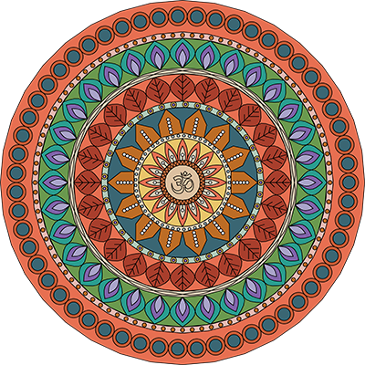
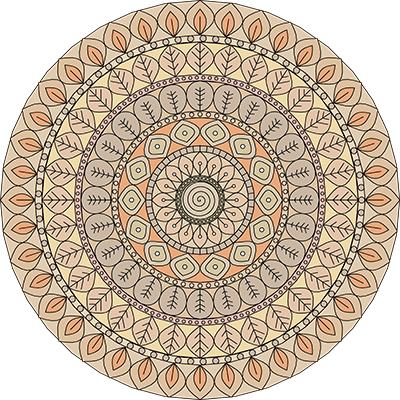

# 🎨 Mandala Generator

A procedural mandala generator in Python using the `turtle` library. Creates unique symmetric drawings with customizable styles, colors, and geometry.
Using the `turtle` library allows you to observe the drawing process.

The code was written using LLM (Large Language Model).


## 🖼️ Examples

<div align="center">


&nbsp; &nbsp; &nbsp; &nbsp;


</div>

## ✨ Features

- **11 center styles**: radial rays, concentric circles, spiral, inner loops, target, Star of David, Om symbol, flower, lotus, sun, knot
- **12 separator band styles**: strokes, circles, zigzag, squares, semicircles, waves, diamonds, and more
- **17 petal layer styles**: flames, leaves, feathers, drops, diamonds, fans, oak leaves, and more
- **Flexible color system**:
  - 4 palette families (warm/cool × soft/bright)
  - Automatic selection without adjacent colors
  - Weighted random selection
  - Modes: always on / always off / random
- **Automatic logging** with phase timings
- **Export to PDF/JPG** via Ghostscript or PIL
- **Adjustable drawing speed** (from instant to smooth animation)

## 📋 Requirements

- Python 3.8+
- `turtle` (included in standard library)
- `Pillow` (for image export)
- `Ghostscript` (optional, for PDF export)

### Installing Dependencies

```bash
pip install -r requirements.txt
```

For PDF export, install Ghostscript:

- **Windows**: [Download Ghostscript](https://ghostscript.com/releases/gsdnld.html)
- **macOS**: `brew install ghostscript`
- **Linux**: `sudo apt-get install ghostscript`

## 🚀 Usage

### Quick Start

```bash
python mandala.py
```

The program will automatically:

1. Generate a random mandala
2. Draw it in a turtle window
3. Save it as PDF/JPG in the `img/` folder
4. Write a generation log to the `log/` folder

### Configuration

Open `mandala.py` and modify the `Config` class:

```python
class Config:
    # Color mode: "yes", "no", "random"
    COLOR_MODE = "yes"

    # Palette choice: "all", "random", "warm_soft", "cool_soft", "warm_bright", "cool_bright"
    PALETTE_CHOICE = "warm_bright"

    # Drawing speed: 0-8 (fast), 9 (instant), 10-20 (smooth)
    DRAW_SPEED_LEVEL = 8

    # Save format: "pdf" or "jpg"
    SAVE_FORMAT = "pdf"

    # Mandala geometry
    CIRCLE_RADIUS = 45
    BAND1_WIDTH = 12
    L1_WIDTH = 55
    # ... and so on
```

## 🎨 Color Modes

| Mode | Description |
| ------ | ------------- |
| `"yes"` | Coloring always enabled |
| `"no"` | Coloring always disabled (black and white mandala) |
| `"random"` | Random choice on each run |

## 🌈 Color Palettes

| Palette | Description |
| --------- | ------------- |
| `"all"` | All colors from all families |
| `"random"` | Random family on each run |
| `"warm_soft"` | Warm pastel tones |
| `"cool_soft"` | Cool pastel tones |
| `"warm_bright"` | Saturated warm tones |
| `"cool_bright"` | Saturated cool tones |

## 📁 Project Structure

```
Mandala/
├── mandala.py          # Main generator file
├── README.md              # Documentation
├── img/                   # Generated images (created automatically)
│   ├── 2026-01-15-mandala-12345.pdf
│   └── ...
└── log/                   # Generation logs (created automatically)
    ├── 2026-01-log.txt
    └── ...
```

## 📊 Logs

Each generation is recorded in a log file `log/YYYY-MM-log.txt` with information:

- Generation date and time
- Color mode and palette
- Selected styles for each area
- Colors used
- Phase timings (if enabled)

Log example:

```
==================================================
Mandala Generation
Date: 2026-01-15 | Start time: 14:23:45
Coloring: enabled (mode: yes)
Color family: warm_bright (Warm-bright)
Drawing speed: 8 (pause 0.00000 s, batch 15 steps)
--------------------------------------------------
 Selected patterns by area:
  1. Central circle:        Variant 7 (Om) [colors: #f4a261 #e76f51]
  2. Separator band 1:      Variant 3 (Zigzag) [color: #e9c46a]
  3. Layer 1:               Variant 4 (Classic leaf) [petals: #bc4749 #bc6c25; ring: #d97642]
  ...
--------------------------------------------------
 Status: Successfully saved -> img/2026-01-15-mandala-12345.pdf
 End time: 14:24:12
==================================================
```

## ⚙️ Advanced Settings

### Enable Timings

```python
TIMING_ENABLED = True
```

Shows execution time for each phase in console and log.

### Disable Ring Filling

```python
PAINT_LAYER_RINGS = False
```

Disables background ring filling under petal layers.

### Modify Geometry

Change radii and widths to create mandalas of different sizes:

```python
CIRCLE_RADIUS = 60      # Larger center
BAND1_WIDTH = 20        # Wider bands
L1_WIDTH = 80           # Taller petal layers
```

## 🐛 Troubleshooting

### Error: "Ghostscript not found"

Install Ghostscript (see "Requirements" section) or change the save format:

```python
SAVE_FORMAT = "jpg"  # Instead of "pdf"
```

### Error: "No module named 'PIL'"

Install Pillow:

```bash
pip install Pillow
```

### Mandala draws too slowly

Increase the speed:

```python
DRAW_SPEED_LEVEL = 9  # Instant drawing
```

### Turtle window doesn't open

Make sure you have a graphical interface. Turtle doesn't work in headless environments (servers without a monitor).

## 📝 License

MIT License - free to use for any purpose.

## 🙏 Acknowledgments

- [turtle](https://docs.python.org/3/library/turtle.html) library - Python's standard graphics library
- [Pillow](https://python-pillow.org/) - image processing
- [Ghostscript](https://ghostscript.com/) - EPS to PDF conversion

## 📧 Contact

Author: [@zah108](https://github.com/zah108)

---

**Happy creating! 🎨✨**
